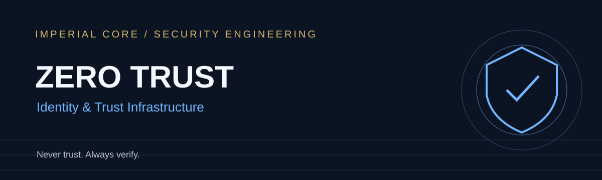

<p align="center"></p>

# ZERO TRUST

**Identity & Trust Infrastructure · IMPERIAL Core**

*Never trust. Always verify.*

Verifies a signed, short-lived laboratory AI Passport against an explicitly trusted Ed25519 public key, expected organization, audience, subject and capability.

**Status: LOCAL TESTED REFERENCE / INDEPENDENT QA PENDING.** No production deployment, certification or real Owner enrollment is claimed.

## Quick start

Node.js 22.13+; no external dependencies or paid services. The local run in this iteration used Node.js 24.22.1.

```sh
npm test
```

Use `RevocationFloor.admit(...)` for the local signed identity and revocation reference. The lower-level `verifyIdentity(...)` checks identity only and does not establish authority.

- [Architecture and release gates](ARCHITECTURE.md)
- [Threat model](THREAT_MODEL.md)
- [Security policy](SECURITY.md)
- [Source](src/index.mjs) · [Tests](test/reference.test.mjs) · [Local test evidence](evidence/LOCAL_TEST_EVIDENCE.md)
- [Authorship](AUTHORS.md) · [Roadmap](ROADMAP.md)

## Limitations

Workload attestation, certificate rotation, live revocation, transport identity and resource-side enforcement are not implemented.

## Related components

[ZERO TRUST](https://github.com/oromaskevic23-cmd/ZERO-TRUST) · [GUARDIAN CORE](https://github.com/oromaskevic23-cmd/GUARDIAN-CORE) · [APPROVAL GATEWAY](https://github.com/oromaskevic23-cmd/APPROVAL-GATEWAY) · [AUDIT LEDGER](https://github.com/oromaskevic23-cmd/AUDIT-LEDGER) · [CYBER HAK](https://github.com/oromaskevic23-cmd/CYBER-HAK-Public)

## Founder and authorship

<p align="center"></p>

**Alexander Nikolaevich Romaskevich (RomaskevicH)** — Founder • Owner • CEO, IMPERIAL Core. Architect / Final Architectural Decision Authority.

Public source visibility is not a license grant. See [LICENSE](LICENSE).

**Architecture Before Implementation. Evidence Before Trust.**

## Local rollback protection

[RevocationFloor](src/revocation-floor.mjs) verifies signed revocation snapshots and persists the latest accepted epoch and content per organization. Stale snapshots, authority substitution and changed revocation contents at the same epoch fail closed. A verified identity is still not permission to execute an action. Key rotation, live issuer integration and resource-side authorization are not implemented.

SQLite files are created with owner-only POSIX permissions; existing files with broader permissions and symlinks are rejected on POSIX. Use a trusted directory and protect the database against replacement. Windows ACL enforcement is not implemented or tested. Replacing the database can erase the stored floor.

## Security hardening v0.2

[Implementation](src/revocation.mjs) · [Tests](test/revocation.test.mjs) · [Evidence and limitations](docs/HARDENING_V0_2.md).

## Security composition v0.3

Combined passport and signed revocation admission. Expected scope, pinned keys and monotonic epoch floor must come from a trusted host; no live issuer or revocation service is deployed.

[Implementation](src/admission.mjs) · [Tests](test/admission.test.mjs) · [Scope and evidence](docs/COMPOSITION_V0_3.md).
